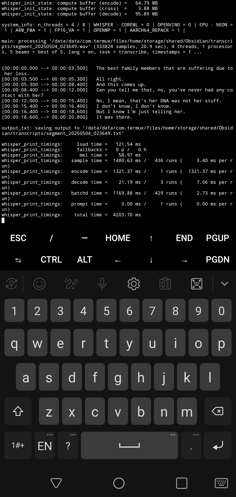
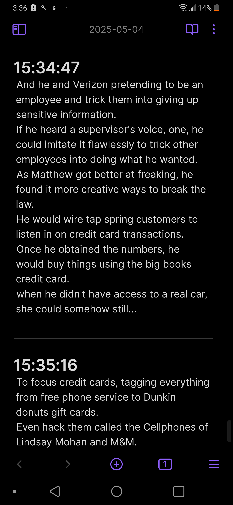

# Audiophile



---



---

## A Continuous Audio Transcription Pipeline


## 1. Summary

This project turns an Android phone into a continuous, hands-free voice
journal. It listens through Termux, decides for itself when an utterance
starts and ends, transcribes each utterance with OpenAI's Whisper model via
whisper.cpp, and appends the text to a daily markdown file that Obsidian can
open.

Since v3 the pipeline is **silence gated**: nothing is sent to whisper while
the room is quiet. One continuous audio stream is decoded all the time, so an
utterance is captured whole — it is never cut at a fixed 30-second boundary —
and it is handed to whisper the moment the speaker stops.

## 2. How It Works

```
termux-microphone-record  ──►  one continuous Ogg/Opus stream (live.ogg)
                                        │  grows in place, readable while written
                                        ▼
                              audiophile-follow.py + ffmpeg (one long-lived decoder)
                                        │  16 kHz mono PCM
                                        ▼
                              audiophile-vad.py
                                 · per-100 ms RMS levels
                                 · tracks the room noise floor
                                 · onset → utterance start (with 2 s pre-roll)
                                 · 1.5 s of silence → utterance end
                                        │  one 16 kHz WAV per utterance
                                        ▼
                              whisper-cli (tiny.en by default)
                                        │
                                        ▼
                          ~/storage/shared/Obsidian/transcripts/YYYY-MM-DD.md
```

Why it is built this way:

* **No fixed slices.** `termux-microphone-record` with a duration limit returns
  immediately and a stop/start cycle loses ~0.3–0.4 s of audio, which cuts
  words in half. v3 starts the recorder once and never restarts it
  mid-sentence.
* **Silence is free.** Whisper fed silence invents text ("you",
  "Thank you.") — v2 did exactly that every 30 seconds. In v3 whisper is
  started only for utterances that contain speech, on audio that begins
  `PREROLL_MS` before the first word and ends 250 ms after the last one.
* **Cheap when idle.** A silent room costs a decode of 32 kB/s of Opus and a
  VAD that does arithmetic on it — measured at 7.8 % of one core on the LG G7
  (ffmpeg ~4.3 %, VAD ~3.1 %), against ~40 % for v2's whisper-every-30 s.
* **Streamable container.** `.m4a`/`.aac`/`.ts` recordings are MP4 files that
  cannot be read until they are finalised. `-e opus` with a `.ogg`/`.webm`
  name produces Ogg/Opus, which can be decoded while it is being written.

The capture file is recycled after 90 s of continuous silence (the gap lands
in silence, so it cannot cut a word), which keeps disk use flat.

## 3. Prerequisites

### Termux Setup

1. **Install Termux**: Download from [F-Droid](https://f-droid.org/en/packages/com.termux/).
2. **Update Packages**:
   ```bash
   pkg update && pkg upgrade
   ```
3. **Install Dependencies**:
   ```bash
   pkg install termux-api ffmpeg git cmake clang wget python
   ```
4. **Grant Microphone Permission**:
   ```bash
   termux-microphone-record -d -f /dev/null
   ```
   Accept the permission prompt when it appears. Open the Termux app itself at
   least once: Android 10 hands **silent audio** (all-zero samples) to capture
   that is started while the app is not running.

### Whisper.cpp Installation

1. **Clone Repository**:
   ```bash
   git clone https://github.com/ggerganov/whisper.cpp.git
   cd whisper.cpp
   ```

2. **Build**:
   ```bash
   cmake -B build
   cmake --build build --config Release
   ```

3. **Download a Model**:
   ```bash
   make -j tiny.en.bin     # fastest / least accurate
   # or
   wget -c https://huggingface.co/ggerganov/whisper.cpp/resolve/main/ggml-base.en.bin \
        -P models/
   ```

## 4. Usage

```bash
termux-setup-storage                        # once, links Termux to Android storage
mkdir -p ~/storage/shared/Obsidian/transcripts
cd ~/Audiophile
chmod +x DTRH-Audiophile.sh audiophile-vad.py audiophile-follow.py audiophile-calibrate.sh
./DTRH-Audiophile.sh
```

Press `Ctrl+C` to stop. The daily journal is
`~/storage/shared/Obsidian/transcripts/YYYY-MM-DD.md`; each utterance is
appended with the wall-clock time it started and its duration:

```markdown
## 16:48:17 (4.60s)

The quick brown fox jumps over the lazy dog.

---
```

### Options

| Flag | Meaning |
| --- | --- |
| *(none)* | run the transcriber |
| `--tail` | follow the log file |
| `--status` | is an instance running? |
| `--stop` | stop the running instance |
| `--selftest` | run the VAD over a synthetic track (2 utterances expected) — works without a microphone |
| `--debug` | verbose logging, including every VAD level decision |
| `--no-notify` | do not touch the notification shade |
| `--work DIR` | write transcripts somewhere else |
| `--model FILE` | use a different ggml model |

### Tuning it to your room

```bash
./audiophile-calibrate.sh 20      # stay quiet for half of it, then talk
```

It prints the dBFS distribution of 100 ms blocks and a suggested threshold. A
typical quiet room sits at −70…−80 dB and close speech at −30…−45 dB, so the
default `DTRH_SPEECH_DB=-55` has ~15 dB of headroom on each side. If the phone
is in a pocket or a noisy café, raise it (e.g. `-45`).

Everything is overridable from the environment, no editing required:

| Variable | Default | Meaning |
| --- | --- | --- |
| `DTRH_SPEECH_DB` | `-55` | a block louder than this is speech |
| `DTRH_MARGIN_DB` | `10` | or this far above the measured noise floor |
| `DTRH_PREROLL_MS` | `2000` | audio kept before the first word |
| `DTRH_END_SILENCE_MS` | `1500` | silence that closes an utterance |
| `DTRH_MIN_SPEECH_MS` | `500` | shorter blips are discarded |
| `DTRH_MIN_VOICED_DB` | `-50` | mean level of the voiced part must beat this |
| `DTRH_WARMUP_MS` | `1500` | ignore the recorder's own start transient |
| `DTRH_MAX_SEGMENT_MS` | `120000` | split a long monologue |
| `DTRH_ROTATE_IDLE_S` | `90` | recycle the capture file after this much silence |
| `DTRH_ROTATE_MAX_MB` | `64` | hard size cap; enforced even in a noisy room |
| `DTRH_THREADS` | `4` | whisper threads |
| `DTRH_WORK` | `~/storage/shared/Obsidian/transcripts` | output directory |
| `DTRH_MODEL` | `~/whisper.cpp/models/ggml-tiny.en.bin` | model |
| `DTRH_NOTIFY` | `1` | live notification |
| `LOG_LEVEL` | `INFO` | `DEBUG` for level-by-level tracing |

Example: a snappier configuration for a meeting room.

```bash
DTRH_SPEECH_DB=-50 DTRH_END_SILENCE_MS=900 ./DTRH-Audiophile.sh --debug
```

### Checking that it works

```bash
./DTRH-Audiophile.sh --selftest
```

This synthesises a track with two tones separated by silence and asserts that
exactly two utterances come out of the VAD. It exercises the whole state
machine without needing speech or a microphone.

## 5. Advanced

### 5a. Termux-API + Termux-Tasker + Tasker Integration

1. **Install Termux:Tasker**: Available on [F-Droid](https://f-droid.org/en/packages/com.termux.tasker/).
2. **Create Tasker Profile**:
   - **Trigger**: Define your desired trigger (e.g., specific time, event).
   - **Action**: Add a Termux action to execute `DTRH-Audiophile.sh`.
3. **Configure Termux:Tasker**:
   - Place `DTRH-Audiophile.sh`, `audiophile-vad.py`, `audiophile-follow.py`
     and `audiophile-calibrate.sh` in `~/.termux/tasker/`.
   - Ensure they are executable:
     ```bash
     chmod +x ~/.termux/tasker/DTRH-Audiophile.sh \
              ~/.termux/tasker/audiophile-vad.py \
              ~/.termux/tasker/audiophile-follow.py
     ```

### 5b. Obsidian Integration

1. **Set Vault Location**: Point your Obsidian vault to `~/storage/shared/Obsidian/`.
2. **Access Transcripts**: Transcriptions are saved in the `transcripts`
   folder as daily markdown files (`YYYY-MM-DD.md`).
3. **Organize Notes**: Utilize Obsidian's features to link, tag, and organize
   your notes. A per-utterance audit trail is kept in
   `transcripts/.audiophile/index.jsonl` (time, duration, level, peak, text) —
   Obsidian ignores dot-directories.

### 5c. Syncthing for Cross-Device Sync

1. **Install Syncthing**:
   - **Android**: Available on [F-Droid](https://f-droid.org/en/packages/com.nutomic.syncthingandroid/).
   - **Desktop**: Available from [Syncthing.net](https://syncthing.net/).
2. **Configure Syncthing**:
   - **Add Folder**: Set the Obsidian vault (`~/storage/shared/Obsidian/`) as a shared folder.
   - **Connect Devices**: Use Syncthing's device ID system to link your device to your desktop.
3. **Sync**: Syncthing will automatically synchronize the folder, ensuring transcriptions are available everywhere.

**Note**: Ensure Syncthing is running on all devices for seamless synchronization.

## 6. Troubleshooting

* **Nothing is transcribed.** Run `./DTRH-Audiophile.sh --debug` and watch the
  `level` lines. If every line reads `db=-91.0`, the microphone is handing the
  process digital silence: open the Termux app once and make sure the
  microphone permission is granted for Termux *and* Termux:API. The script
  warns about this explicitly at startup.
* **Speech is cut at the start.** Increase `DTRH_PREROLL_MS` (default 2000).
* **One utterance is split into two.** Increase `DTRH_END_SILENCE_MS`
  (default 1500) — a slow speaker with long pauses needs more.
* **Two sentences are glued together.** Decrease `DTRH_END_SILENCE_MS`.
* **Nothing is ever detected in a noisy room.** Raise `DTRH_SPEECH_DB`
  (e.g. `-45`) or run `./audiophile-calibrate.sh`.
* **Some utterances leave no entry in the journal.** Run with `--debug` and
  look for `dropped whisper artefact (non-speech annotation): "(music)"` or
  `dropped 3.2s of audio: quiet`. Whisper describes non-speech with bracketed
  annotations and they are dropped on purpose; `quiet` means the segment never
  got above `DTRH_MIN_VOICED_DB`.
* **Whisper ran but nothing was written.** Same thing — the audio was music,
  a video or a door, not a voice. Raise or lower `DTRH_MIN_VOICED_DB` to taste.
* **The capture file keeps growing.** It is recycled after 90 s of silence, and
  hard-capped by `DTRH_ROTATE_MAX_MB` even when the room is never quiet (a
  noisy room never reports idle). Lower the cap if disk is tight. Larger
  models make fewer mistakes: `DTRH_MODEL=~/whisper.cpp/models/ggml-base.en.bin`.
* **It stops overnight.** Make sure the Termux wake lock is held
  (`termux-wake-lock`, done by the script) and disable battery optimisation for
  Termux and Termux:API in Android settings.
* **`--stop` says "not running" but the mic is still busy.**
  `termux-microphone-record -q` clears a stuck recorder.

## 7. Design notes

`docs/JOURNAL.md` records the measurements behind every decision (recorder
timing, container streamability, dB levels, whisper latency) and the two
approaches that were measured and rejected.

## 8. License

This project is licensed under the MIT License.
